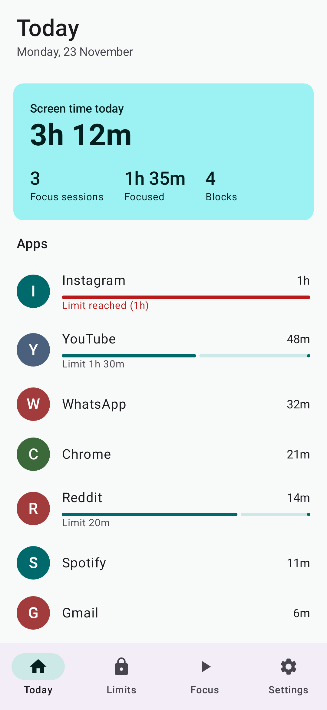
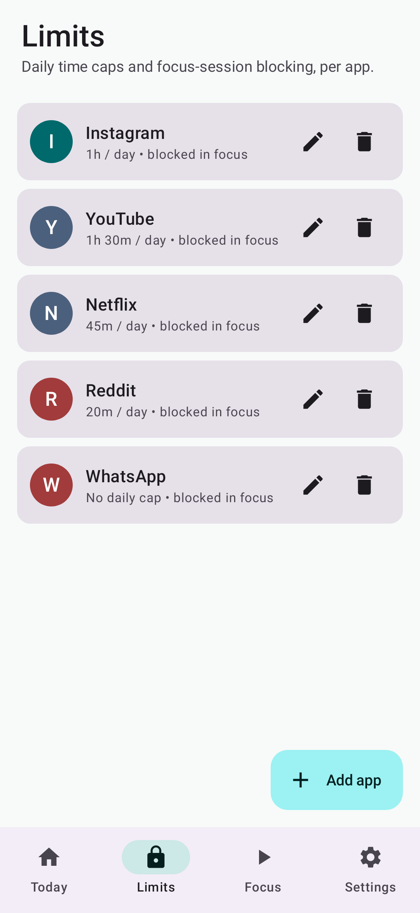
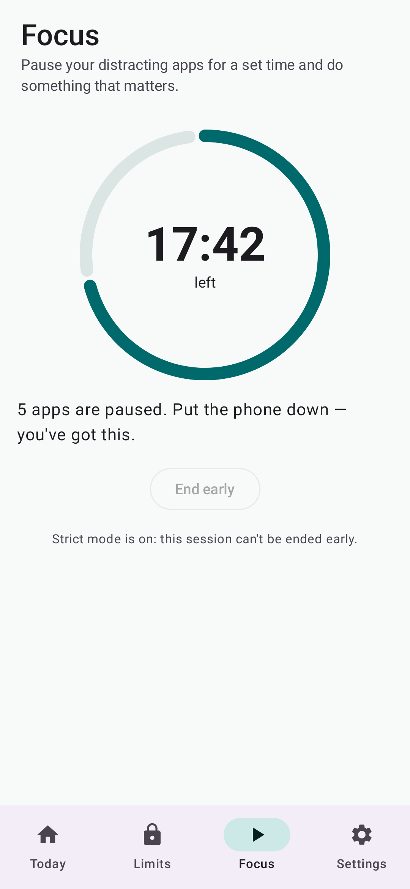
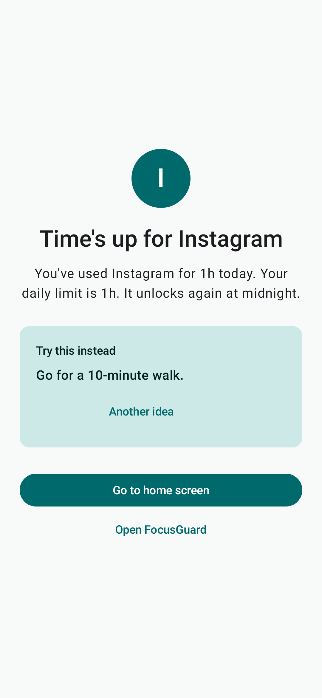
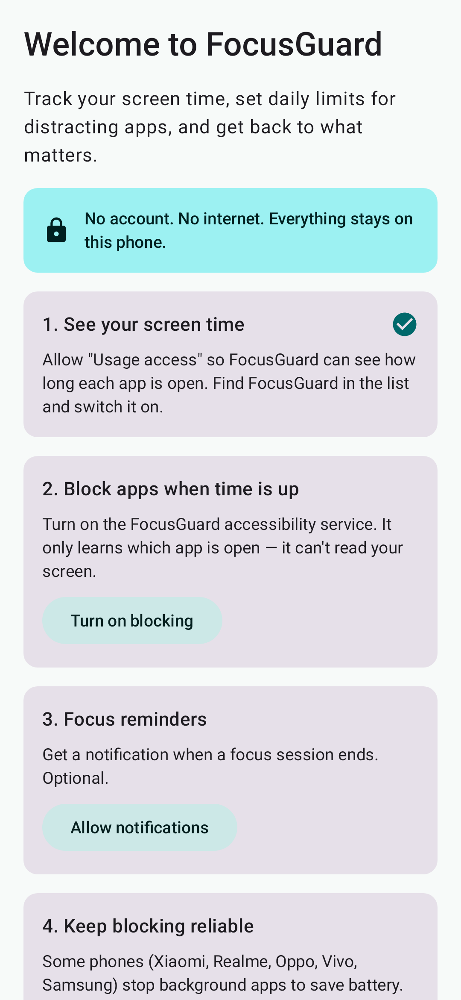
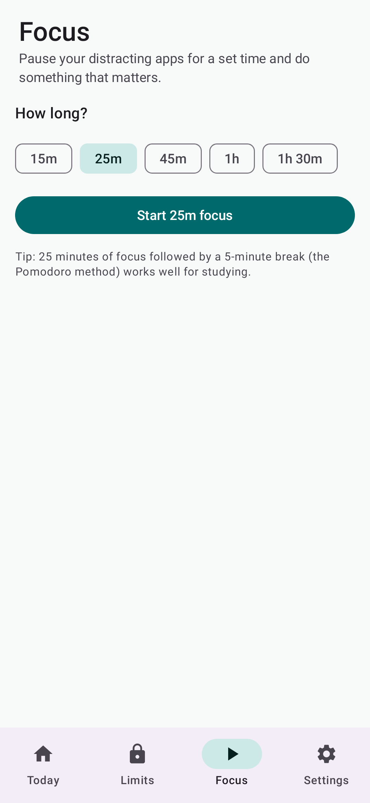
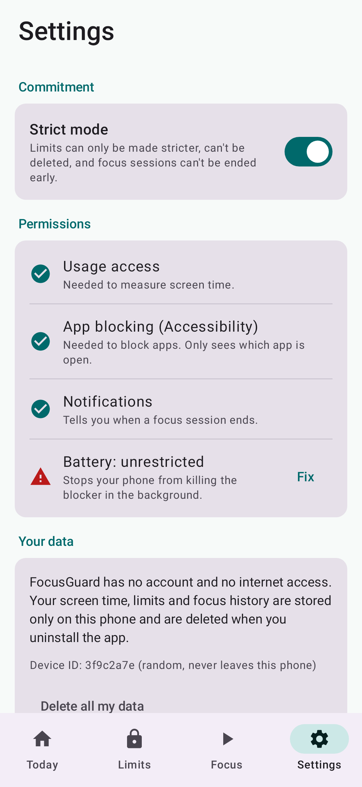
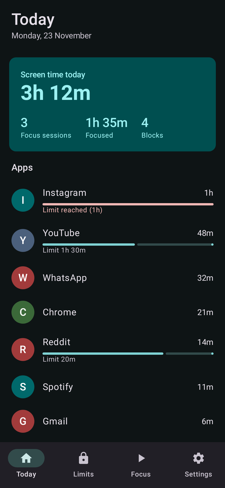

# FocusGuard v1.0: screen time tracker and app blocker (offline)

FocusGuard tracks how long you use each app, enforces daily limits, and runs focus sessions that pause distracting apps.
**v1.0 has no login, no server and no INTERNET permission.** All data stays on the phone.

**[⬇ Download the latest APK](https://github.com/saraswatdeepesh19/FocusGuard/releases/download/latest/app-debug.apk)**. Open this link on your Android phone, then tap the file to install.

## Screenshots

| Today | Limits | Focus session | Block screen |
|:---:|:---:|:---:|:---:|
|  |  |  |  |
| Total time, per-app usage, red when a limit is reached | Daily cap and/or "block during focus" for each app | Live countdown; strict mode stops ending early | Covers the app and suggests something better to do |

| First-run setup | Start a focus session | Settings | Dark mode |
|:---:|:---:|:---:|:---:|
|  |  |  |  |
| No account, just the permissions you need, each explained | 15 minutes to 1h 30m, Pomodoro-friendly | Strict mode, permission checks, delete your data | Follows the phone's theme |

<sub>The screenshots use sample data and are rendered automatically from the real UI code by [`ReadmeScreenshots`](app/src/test/java/com/focusguard/app/ui/ReadmeScreenshots.kt) (Roborazzi + Robolectric). They're regenerated whenever UI code changes (`.github/workflows/screenshots.yml`). App icons appear as letter avatars in the screenshots; on a phone you see each app's real icon.</sub>

## Features

| Screen | What it does |
|---|---|
| **Onboarding** | Explains each permission in plain words before sending you to system Settings, including the accessibility disclosure Google Play requires |
| **Today** | Total screen time, time per app, progress bars against limits, focus sessions and blocks today |
| **Limits** | Pick any app → set a daily cap (5 min–4 h) and/or "block during focus sessions" |
| **Focus** | 15/25/45/60/90-minute sessions with a live countdown; blocked apps can't be opened |
| **Block screen** | Covers the blocked app and suggests something else to do (walk, read, stretch…) |
| **Settings** | Strict mode, permission health check, "Delete all my data" |

**Strict mode:** limits can only get stricter (lower minutes, more blocking), can't be deleted, and focus sessions can't be ended early. You can't turn it off during a focus session.

## How to build and run

1. Install **Android Studio** (Ladybug 2024.2 or newer; its bundled JDK 17/21 works).
2. **File → Open** → select this `FocusGuard` folder. Let Gradle sync (the first sync downloads ~1 GB).
3. If Android Studio offers to upgrade AGP/Kotlin, you can accept. The project uses AGP 8.7.3, Kotlin 2.0.21, Gradle 8.11.1.
4. Connect an Android phone with USB debugging on (or start an emulator), then press **Run ▶**.
5. Unit tests: `./gradlew testDebugUnitTest` (covers the block rules, strict mode and time formatting).
6. Regenerate README screenshots: `./gradlew testDebugUnitTest --tests "*ReadmeScreenshots" -Proborazzi.test.record=true`.

**No Android Studio?** Every push to `main` is built by GitHub Actions (`.github/workflows/build-apk.yml`), and the APK is published on the [Releases page](https://github.com/saraswatdeepesh19/FocusGuard/releases/tag/latest).

**Testing on a real phone is strongly recommended.** Emulators don't show realistic usage data.

### Enabling the blocker on a sideloaded build
On Android 13+, apps installed outside the Play Store can't turn on an accessibility service at first: the switch is greyed out ("Restricted setting").
Fix: **Settings → Apps → FocusGuard → ⋮ (top-right) → Allow restricted settings**, then turn on the service again.

## Architecture

```
ui/ (Jetpack Compose)          Onboarding, Today, Limits, Focus, Settings, BlockActivity
        │
domain/BlockPolicy             Pure "should this app be blocked?" + strict-mode rules (unit-tested)
        │
data/ repositories             LimitRepository, FocusRepository, UsageRepository, SettingsStore
        │
Room (SQLite) + DataStore      Everything stored locally on the phone
        ▲
service/BlockerAccessibilityService   Watches which app opens → enforces rules → shows BlockActivity
work/UsageSnapshotWorker              Every 6 h saves daily per-app totals (long-term history)
```

**How blocking works:**
1. Android tells the accessibility service each time a new app comes to the front. The service only gets the **package name**: `canRetrieveWindowContent="false"`, so it cannot read anything on screen.
2. If that app has a rule, `BlockPolicy.decide()` checks today's usage (from `UsageStatsManager` events) and whether a focus session is running.
3. To block an app, the service presses Home and opens `BlockActivity`.
4. Every 5 seconds a check catches a limit running out while you're still in the app, and finishes expired focus sessions.

**Why usage is calculated from raw events:** `queryUsageStats()` sums usage into system "buckets" that don't line up with midnight, so its totals for "today" are often wrong. `UsageRepository` replays the app open/close events since midnight instead. It also stops counting when the screen turns off.

## Built ready for v2 (login + cloud sync)

You won't need to rewrite the database for v2:

- **Install ID**: a random UUID is created on first launch (`SettingsStore.ensureInstallId`). In v2, link it to the user's account after login so their history carries over.
- **Every table** has `id` (UUID), `created_at`, `updated_at`, `sync_status` and `deleted` (soft delete).
  v1 writes `LOCAL_ONLY`. In v2, change new writes to `PENDING`, and have a WorkManager sync job upload `PENDING` rows and mark them `SYNCED`.
  `SyncStatus.afterLocalEdit()` already handles marking an edited `SYNCED` row as `PENDING` again.
- **Room schema export** is on (`app/schemas/`). In v2, bump the database version and write a `Migration`. Never use destructive migration once users have data.
- **`AppContainer`** is the single place to add an auth client and sync engine. Screens don't need to change.

v2 checklist: add the INTERNET permission → login screen (optional; the app must still work offline) → consent screen → sync worker → in-app account deletion → update the Play Data safety form **before** release → privacy policy that matches what the app really collects (India's DPDP Act: consent, purpose, erasure; verifiable parental consent for users under 18).

## Before publishing on Google Play

- [ ] **Accessibility declaration** in Play Console (App content → Sensitive permissions). State that the API is used to block apps chosen by the user, and that no screen content is read. Upload a short video of the disclosure dialog and the blocking flow.
- [ ] **Prominent disclosure**: already built in (`AccessibilityDisclosureDialog`). It's shown and must be accepted before the user is sent to Accessibility settings.
- [ ] **Usage access** (`PACKAGE_USAGE_STATS`): fill in its declaration in Play Console if asked.
- [ ] **Data safety form** for v1: "No data collected, no data shared". This is true because the app has no internet permission.
- [ ] **Privacy policy URL**: required even for v1 because of the sensitive permissions. Say that all data stays on the device.
- [ ] **Target SDK**: set `targetSdk` to the level Play currently requires (raise it in `app/build.gradle.kts` if Play Console asks).
- [ ] Create a release keystore (Build → Generate Signed App Bundle). **Never commit it to git.**

## Known limitations of v1.0

- The user can still turn off the accessibility service or uninstall the app. A later version could add an optional Device Admin "uninstall protection" (Play reviews this closely).
- Some phones (Xiaomi, Realme, Oppo, Vivo) kill background services aggressively. Onboarding tells users to set battery to Unrestricted and turn on Autostart.
- Reels/Shorts-only blocking (blocking part of an app) needs window-content access. It's planned for v1.x as a separate, opt-in setting with its own disclosure.

## Roadmap

- **v1.1**: weekly report from `daily_usage`, home-screen widget, scheduled blocking (e.g. 10 PM–7 AM), Hindi strings.
- **v1.2**: Reels/Shorts blocking (opt-in), app groups ("Social", "Games").
- **v2.0**: optional login, backup and sync, consent and deletion flows.
